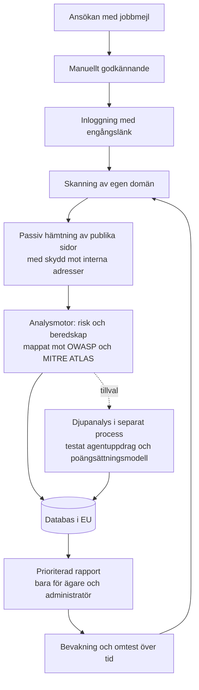

# Agentkoll

Agentkoll visar vad en AI-agent kan göra på en hemsida som den inte borde. Tjänsten gör ett passivt säkerhetstest av hemsidans publika delar och ger en rapport med prioriterade åtgärder.

Live: https://agentkoll.se

Det här repot beskriver den tekniska lösningen på en övergripande nivå. Källkoden är privat.

## Problemet

AI-agenter läser, klickar och fyller i formulär åt sina användare. Det som en människa gör en gång kan en agent göra tusentals gånger. Agenter kan också luras av dold text på en sida. De flesta företag vet inte vilka delar av hemsidan som är öppna för agenter eller hur väl de är skyddade.

## Lösningen i korthet

1. **Ansökan och godkännande.** Man ansöker med jobbmejl och varje ansökan granskas manuellt. Inloggning sker med en personlig engångslänk.
   Vad det ger kunden: verktyget används bara av behöriga personer och inte mot andras hemsidor.
2. **Skanning av publika delar av hemsidan.** Skanningen är begränsad till den egna domänen och hämtar bara det som redan är publikt.
   Vad det ger kunden: ingen installation, inga inloggningsuppgifter och ingen påverkan på driften.
3. **Passiv analys.** Analysmotorn loggar inte in, skickar inga formulär och försöker inte utnyttja sårbarheter.
   Vad det ger kunden: testet är säkert att köra mot en hemsida i produktion.
4. **Skydd mot interna adresser.** Skannern kan inte styras mot interna nätverk eller andra adresser som inte hör till den publika hemsidan.
   Vad det ger kunden: tjänsten kan inte användas som en väg in i någon annans miljö.
5. **Riskbedömning mot erkända ramverk.** Fynden bedöms efter allvarlighetsgrad och mappas mot OWASP Top 10 för LLM-applikationer, OWASP Top 10 för agentiska applikationer och MITRE ATLAS.
   Vad det ger kunden: resultatet går att lägga in direkt i befintligt säkerhets- och riskarbete.
6. **Prioriterad rapport.** Rapporten har två mått, Agentrisk och Beredskap, fynd efter allvarlighetsgrad och åtgärder i prioritetsordning.
   Vad det ger kunden: det blir tydligt vad som ska åtgärdas först.
7. **Djupanalys med testat agentuppdrag.** Som tillval körs en djupare analys i en separat process. En agent får ett uppdrag på hemsidan och resultatet bedöms med en poängsättningsmodell.
   Vad det ger kunden: man ser hur en verklig agent beter sig på hemsidan, inte bara vad som går att läsa av.
8. **Bevakning över tid.** Hemsidan kan skannas om och resultaten jämföras före och efter.
   Vad det ger kunden: man ser om åtgärderna gav effekt och upptäcker nya risker.
9. **Lagring i EU och åtkomstkontroll.** All data lagras i en databas i EU. En rapport är synlig bara för ägaren och administratören.
   Vad det ger kunden: resultaten stannar inom EU och delas inte med obehöriga.

## Mer information

- [Arkitektur](docs/arkitektur.md)
- [Säkerhet och integritet](docs/sakerhet-och-integritet.md)

## Licens

© 2026 Kevin Malmgren. Alla rättigheter förbehållna. Se `LICENSE`.
