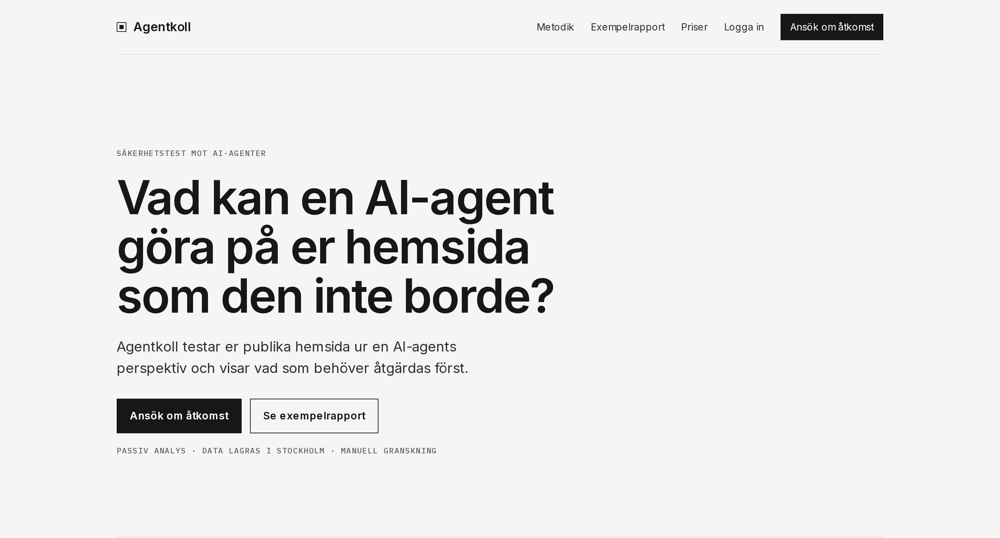
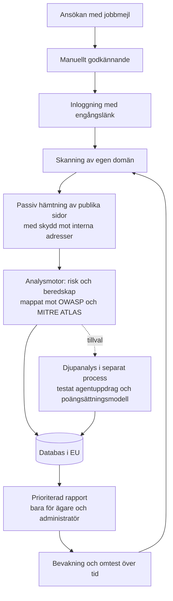

# Agentkoll

Agentkoll visar vad en AI-agent kan göra på en hemsida som den inte borde. Tjänsten gör ett passivt säkerhetstest av hemsidans publika delar och ger en rapport med prioriterade åtgärder.

Live: https://agentkoll.se

Det här repot beskriver den tekniska lösningen på en övergripande nivå. Källkoden är privat.

## Problemet

AI-agenter läser och agerar på publika hemsidor. Det gäller webbläsaragenter som klickar och fyller i formulär åt en användare, sökagenter som hämtar och sammanfattar innehåll och kodagenter som läser dokumentation och publik kod. Det som en människa gör en gång kan en agent göra tusentals gånger, och en agent läser även det som inte syns på skärmen.

De flesta företag vet sällan vad deras hemsida exponerar för agenter: vilken text agenten faktiskt läser, vilka handlingar den kan nå, vilka uppgifter som går att hämta och vilka regler som gäller för agenter.

## Riskerna

Riskerna nedan är de som Agentkoll kontrollerar. De utgår från tre publika ramverk: [OWASP Top 10 för LLM-applikationer 2025](https://genai.owasp.org/llm-top-10/), [OWASP Top 10 för agentiska applikationer](https://genai.owasp.org/resource/owasp-top-10-for-agentic-applications-for-2026/) och [MITRE ATLAS](https://atlas.mitre.org/).

1. **Indirekt promptinjektion via dold text och metadata.** Agenter läser hela sidan, även dold text, kommentarer, attribut och filer för agenter. Text som ger agenten order kan styra om den, till exempel att rekommendera fel sak eller dölja något för användaren. (OWASP LLM01, OWASP ASI01, MITRE ATLAS Indirect Prompt Injection)
2. **Exponerade nycklar och hemligheter i publik kod.** Hemliga nycklar i JavaScript som skickas till webbläsaren kan läsas av vem som helst, även av agenter som sedan kan använda dem. Det gäller särskilt nycklar till AI-tjänster och betalning. (OWASP LLM02, OWASP ASI03, MITRE ATLAS Unsecured Credentials)
3. **Oskyddade formulär och funktioner som agenter kan automatisera.** Kontoskapande, inloggning, formulär, uppladdning och kassa utan synligt skydd kan användas automatiskt och i stor skala. Ju fler handlingar en agent kan nå, desto större blir risken för oavsiktliga eller överdrivna handlingar. (OWASP LLM06 Excessive Agency, OWASP ASI02)
4. **Informationsläckage via svar och inställningar.** Öppna inställningar för delning mellan domäner, versionsnummer i svar från servern och svaga cookie-inställningar gör mer tillgängligt än avsett. Det en agent kan läsa kan den sammanfatta, spara och vidarebefordra. (OWASP LLM02)
5. **Otydliga regler för agenter.** Utan regler i robots.txt för AI-agenter och utan en publik agentpolicy går det inte att skilja tillåten användning från missbruk, och en agent som utger sig för att agera åt en kund behandlas som alla andra. (OWASP ASI03, OWASP ASI09)
6. **Feltolkning och felinformation.** Om innehållet är svårt för agenter att läsa, till exempel när det bara visas med JavaScript eller saknar strukturerad data, kan agenten sammanfatta fel om företaget, dess erbjudande eller villkor. Det blir en varumärkesrisk. (OWASP LLM09 Misinformation)

## Lösningen

| Risk | Vad Agentkoll gör | Vad det ger kunden |
|---|---|---|
| Indirekt promptinjektion | Söker igenom synlig och dold text, kommentarer, attribut och filer för agenter efter instruktioner riktade till agenter och mäter mängden dold text. | Man ser om hemsidan innehåller text som kan styra om en agent, och var den finns. |
| Exponerade nycklar | Söker i den publika koden efter kända format för hemliga nycklar. | Läckta nycklar upptäcks innan någon annan hittar och använder dem. |
| Oskyddade formulär och funktioner | Bygger en agentbehörighetskarta över känsliga handlingar som går att nå från startsidan och om något skydd syns. Inget provas. | En överblick över vad en agent kan göra och vilka flöden som behöver skydd. |
| Informationsläckage | Granskar säkerhetsinställningar i serverns svar, delning mellan domäner, cookies och versionsuppgifter. | Konkreta inställningar att skärpa, i prioritetsordning. |
| Otydliga regler för agenter | Läser robots.txt för namngivna AI-agenter och letar efter en publik agentpolicy. | Underlag för att bestämma vad agenter får och inte får göra, och för att visa det tydligt. |
| Feltolkning och felinformation | Bedömer Beredskap: om innehållet går att läsa utan JavaScript och har titel, beskrivning, strukturerad data och filer för agenter. Djupanalysen ger en agent ett uppdrag på hemsidan och bedömer resultatet. | Större chans att agenter återger företaget korrekt, och ett exempel på hur en agent faktiskt uppfattar hemsidan. |

Varje fynd får en allvarlighetsgrad och mappas mot ramverken ovan, så att resultatet går att lägga in i befintligt säkerhets- och riskarbete.

## Hur tjänsten fungerar

1. **Ansökan och godkännande.** Man ansöker med jobbmejl och varje ansökan granskas manuellt. Inloggning sker med en personlig engångslänk.
   Vad det ger kunden: verktyget används bara av behöriga personer och inte mot andras hemsidor.
2. **Skanning av publika delar av hemsidan.** Skanningen är begränsad till den egna domänen och hämtar bara det som redan är publikt.
   Vad det ger kunden: ingen installation, inga inloggningsuppgifter och ingen påverkan på driften.
3. **Passiv analys.** Analysmotorn loggar inte in, skickar inga formulär och försöker inte utnyttja sårbarheter.
   Vad det ger kunden: testet är säkert att köra mot en hemsida i produktion.
4. **Skydd mot interna adresser.** Skannern kan inte styras mot interna nätverk eller andra adresser som inte hör till den publika hemsidan.
   Vad det ger kunden: tjänsten kan inte användas som en väg in i någon annans miljö.
5. **Riskbedömning mot erkända ramverk.** Fynden bedöms efter allvarlighetsgrad och mappas mot OWASP Top 10 för LLM-applikationer, OWASP Top 10 för agentiska applikationer och MITRE ATLAS.
   Vad det ger kunden: resultatet går att lägga in direkt i befintligt säkerhets- och riskarbete.
6. **Prioriterad rapport.** Rapporten har två mått, Agentrisk och Beredskap, fynd efter allvarlighetsgrad och åtgärder i prioritetsordning.
   Vad det ger kunden: det blir tydligt vad som ska åtgärdas först.
7. **Djupanalys med testat agentuppdrag.** Som tillval körs en djupare analys i en separat process. En agent får ett uppdrag på hemsidan och resultatet bedöms med en poängsättningsmodell.
   Vad det ger kunden: man ser hur en verklig agent beter sig på hemsidan, inte bara vad som går att läsa av.
8. **Bevakning över tid.** Hemsidan kan skannas om och resultaten jämföras före och efter.
   Vad det ger kunden: man ser om åtgärderna gav effekt och upptäcker nya risker.
9. **Lagring i EU och åtkomstkontroll.** All data lagras i en databas i EU. En rapport är synlig bara för ägaren och administratören.
   Vad det ger kunden: resultaten stannar inom EU och delas inte med obehöriga.

## Mer information

- [Arkitektur](docs/arkitektur.md)
- [Säkerhet och integritet](docs/sakerhet-och-integritet.md)

## Licens

© 2026 Kevin Malmgren. Alla rättigheter förbehållna. Se `LICENSE`.
