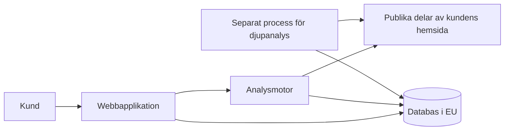

# Arkitektur

Lösningen består av fyra delar.

- **Webbapplikation.** Publika sidor, ansökan, inloggning och rapporter. Varje sida finns även i en form som är lätt för AI-agenter att läsa.
- **Analysmotor.** Hämtar hemsidans publika delar passivt och bedömer risk och beredskap.
- **Separat process för djupanalys.** Kör det testade agentuppdraget och poängsättningsmodellen, skild från webbapplikationen.
- **Databas i EU.** Lagrar konton, skanningar och rapporter. Den nås bara via serverkod.

Delarna är åtskilda så att den tyngre djupanalysen inte påverkar webbapplikationen och så att varje del bara har den behörighet den behöver.
